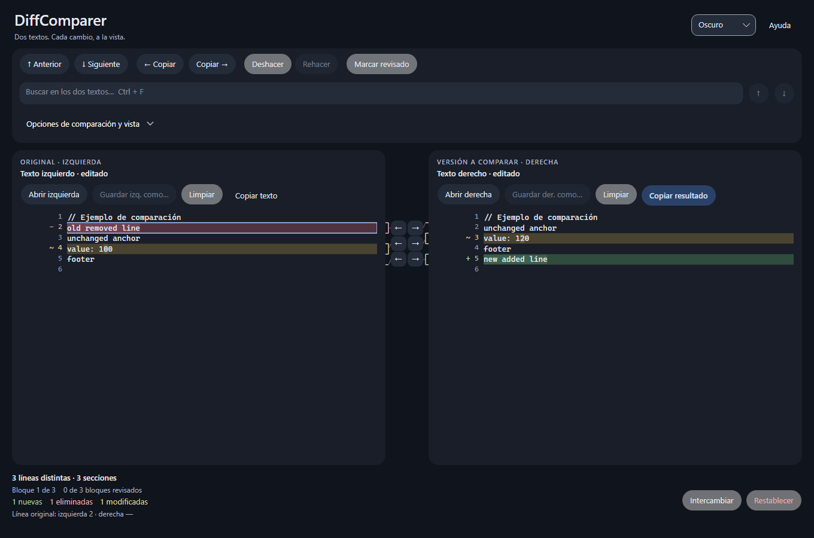

# DiffComparer

Aplicación de escritorio para comparar y editar texto o código lado a lado. Las diferencias se actualizan mientras escribes y puedes copiar secciones completas en ambas direcciones.

Desarrollada con **.NET 10** y **Avalonia**, con interfaz en **español**.

[English](README.md) · [Arquitectura del motor](docs/ENGINE_IMPLEMENTATION.es.md) · [Diseño de interfaz](docs/UI_DESIGN.es.md)



*Modo oscuro. [Ver el ejemplo en modo claro](docs/images/comparison-light.png).*

## Qué puedes hacer

- **Comparar mientras editas:** ambos textos permanecen editables y las diferencias se actualizan automáticamente.
- **Entender los cambios:** colores suaves, fragmentos destacados, números de línea originales y corchetes que delimitan cada sección.
- **Copiar secciones:** lleva cambios de un lado al otro y deshaz o rehace las copias.
- **Concentrarte en la revisión:** busca, filtra los cambios y marca las secciones que ya comprobaste.
- **Trabajar con comodidad:** temas claro, oscuro y del sistema, paneles ajustables, atajos y ayudas sencillas.
- **Abrir, guardar y compartir:** conserva la codificación de tus archivos, copia el resultado al portapapeles o exporta un informe o parche.
- **Recuperarte de un error:** limpia un panel, intercambia los textos o restablece las opciones, con recuperación de los textos y ajustes anteriores.

## Empezar desde el código fuente

Instala el SDK de .NET 10 y ejecuta este comando desde la carpeta del repositorio:

```powershell
dotnet run --project DiffComparer.UI
```

Abre un archivo en cada panel o pega tus textos. **La izquierda es el original** y la derecha es la versión que quieres comparar. No hace falta pulsar un botón para comparar.

## Interfaz y apariencia

El selector superior permite elegir Claro, Oscuro o Sistema. Los dos textos permanecen editables; las ayudas explican cada acción al pasar el puntero. Las opciones menos frecuentes están en **Opciones de comparación y vista**; **Listo** o **Esc** cierran ese panel.

Cada lado permite abrir, guardar, limpiar y copiar su texto. **Copiar resultado** copia todo el panel derecho al portapapeles. **Intercambiar** cambia los textos de lado; **Restablecer** vacía ambos y devuelve las opciones iniciales. **Recuperar textos** restaura los textos y opciones anteriores a la última de estas acciones. No modifica los archivos guardados.

La presentación está inspirada en Material Design 3 y aplica criterios de usabilidad de Nielsen. Decisiones, referencias, pruebas y límites: [diseño de interfaz](docs/UI_DESIGN.es.md).

## Comparar y analizar

1. Abre los archivos izquierdo y derecho o pega texto en los editores. Cada cabecera muestra el nombre, la codificación y los finales de línea; la ruta completa aparece al pasar el cursor.
2. La lectura automática reconoce BOM de UTF-8, UTF-16 y UTF-32; sin BOM usa UTF-8 estricto. Si el archivo utiliza otra codificación, selecciona UTF-16 o Windows-1252 antes de abrirlo. Los errores de decodificación se muestran sin sustituir silenciosamente caracteres.
3. Por defecto se compara el contenido exacto, incluidos los espacios. **Ignorar espacios** activa la normalización de espacios y tabulaciones, incluso dentro de cadenas. **Comparar EOL** incluye diferencias CRLF/LF/CR; la presencia del salto final siempre se compara. **Legible** utiliza anclas y Myers; **Mínimo** minimiza inserciones y eliminaciones de líneas.
4. Ambos paneles permanecen editables. Las diferencias se actualizan automáticamente tras una pausa de 250 ms al escribir, pegar o cambiar las opciones. Las líneas agregadas tienen fondo verde; las eliminadas, rojo; las modificadas, amarillo. Los fragmentos cambiados usan un tono más intenso del mismo color. La izquierda se considera el original. No se insertan filas vacías ni se mueve el cursor al actualizar.
5. La barra inferior resume las líneas distintas, las secciones y el avance de la revisión. Los indicadores `+`, `−` y `~` junto al número de línea identifican cambios sin depender solo del color. Una sección puede abarcar varias líneas.

## Vista y revisión

- **Resaltar solo diferencias:** atenúa el texto fuera de los cambios y su contexto, y limita la búsqueda y la navegación a esa selección. El control **Líneas alrededor** permite ampliar el texto destacado alrededor de los cambios. Los documentos completos siguen visibles y editables.
- **Agregadas / Eliminadas / Modificadas:** filtran los tipos visibles sin alterar los totales globales. El contexto no vuelve a mostrar tipos excluidos.
- **Solo movidas:** muestra movimientos de texto idéntico y sin ambigüedad, identificados como agregados y eliminados. Los movimientos conservan sus filas de eliminación e inserción y no se cuentan como una categoría adicional de líneas.
- **Buscar:** busca sin distinguir mayúsculas en ambos paneles visibles. **Enfocar resultados** limita el resaltado y la navegación al texto encontrado y su contexto. Los resultados se limitan a 50.000, con aviso cuando se alcanza el límite.
- **Marcar revisado:** registra la revisión del bloque actual y muestra ✓ junto a sus números de línea; **Sin revisar** permite trabajar con los pendientes. Al recalcular se conserva únicamente para bloques únicos cuyo contenido y contexto inmediato no cambiaron. Se incluye en el informe HTML.
- **Espacios visibles:** muestra espacios, tabulaciones y finales de línea. El selector de lenguaje aplica resaltado de sintaxis; **Automático** usa la extensión del archivo.

| Atajo | Acción |
| --- | --- |
| F7 / Shift+F7 | Bloque siguiente / anterior, entre los visibles |
| Ctrl+F | Enfocar la búsqueda |
| F3 / Shift+F3 | Coincidencia siguiente / anterior, en ambos paneles |
| Ctrl+Z / Ctrl+Y | Deshacer / rehacer en el editor enfocado, incluidas las copias |
| Esc | Cerrar el panel de opciones |

Los botones **Deshacer/Rehacer** permiten revertir copias y, cuando no hay copias pendientes en el historial, las ediciones del último panel enfocado. Los atajos Ctrl+Z/Ctrl+Y actúan directamente sobre el editor enfocado.

La navegación es circular y usa las líneas originales de cada documento. Los filtros afectan el resaltado y la navegación; no ocultan ni sustituyen el texto editable.

## Copiar y guardar

Las flechas centrales copian el bloque completo en la dirección indicada; las de la barra actúan sobre el bloque seleccionado. Cada copia es una operación reversible y recalcula el diff en segundo plano. Se validan la identidad y revisión de ambos documentos antes de modificar texto. No se puede aplicar una copia de una comparación anterior ni una sección parcialmente excluida por los filtros.

Por defecto se conserva el estilo de saltos de línea del destino. Desactiva **Conservar EOL destino** para copiar los terminadores de origen; **Comparar EOL** siempre los copia. El símbolo ¶ junto al número de línea señala cambios de terminador o del salto final.

**Guardar izq./der. como…** guarda el documento real, sin filas de alineación ni filtros. Conserva codificación, BOM y saltos de línea; el texto pegado se guarda como UTF-8 sin BOM. La codificación se valida antes de abrir el destino. Cancelar o fallar no marca el documento como guardado.

## Limpiar, intercambiar y recuperar

- **Limpiar:** vacía únicamente el panel donde pulsaste el botón.
- **Intercambiar:** cambia los textos de lado. El texto que queda a la izquierda pasa a ser el original de la comparación.
- **Restablecer:** vacía ambos paneles y devuelve las opciones de comparación a sus valores iniciales. Conserva el tema elegido.
- **Recuperar textos:** restaura ambos textos y las opciones anteriores a la última limpieza, intercambio o restablecimiento.

La recuperación conserva una sola instantánea, no un historial ilimitado, y no recupera las marcas de revisión de una sesión restablecida. Estas acciones no modifican los archivos guardados. **Copiar resultado** copia todo el texto derecho, aunque haya filtros activos.

## Exportar

- **Informe HTML:** comparación completa, números originales, reglas aplicadas, movimientos y revisión. El contenido se escapa para no ejecutar texto de los archivos como HTML.
- **Parche:** unified diff del contenido completo, independiente de filtros y de la opción de ignorar espacios. Conserva si existe un salto final. Utiliza un único bloque con todo el contexto y normaliza el estilo de finales de línea; no es una comparación binaria.

Las exportaciones solicitan un archivo de destino y nunca escriben sobre los archivos comparados por iniciativa propia.

## Motor y rendimiento

La comparación combina anclas legibles o Myers mínimo con un refinamiento de los fragmentos por grafemas Unicode. Los documentos editables, los resultados y las vistas filtradas se mantienen separados.

La comparación, la lectura de archivos, los filtros, la búsqueda y la preparación de informes trabajan en segundo plano. Los cálculos usan capturas inmutables y validan las versiones antes de publicar resultados o copiar cambios. El recálculo actual es completo y cancela el trabajo obsoleto; las entradas muy diferentes pueden seguir siendo costosas.

Los algoritmos, las decisiones de rendimiento y sus límites se describen en la [documentación del motor](docs/ENGINE_IMPLEMENTATION.es.md).

## Compilar y probar

Requiere el SDK de .NET 10.

```powershell
dotnet test DiffComparer.slnx -c Release
```

Las pruebas incluyen motor, filtros, revisión, codificaciones, exportaciones y ventanas renderizadas con Avalonia Headless. También comprueban los temas, el contraste, la distribución compacta, las ayudas y la recuperación de textos. No necesitan abrir ventanas del escritorio; los diálogos de archivos y el portapapeles utilizan servicios simulados. La prueba `PerformanceSmokeTests` mide una comparación de 20.000 líneas; sus tiempos dependen del equipo.

Para guardar capturas, mediciones y ejemplos de parches:

```powershell
$env:DIFFCOMPARER_TEST_ARTIFACTS = Join-Path $PWD 'artifacts'
dotnet test DiffComparer.slnx -c Release
```

## Alcance y límites

El análisis es textual: no interpreta semánticamente código, JSON ni XML. La detección conservadora de movimientos no intenta adivinar bloques repetidos o movidos con ediciones. Los textos modificados en el editor no se guardan automáticamente y las revisiones no persisten entre sesiones.

Actualmente no se admiten comparación de carpetas, combinación de tres versiones con ancestro común, recálculo incremental, sesiones persistentes ni arrastrar archivos.
