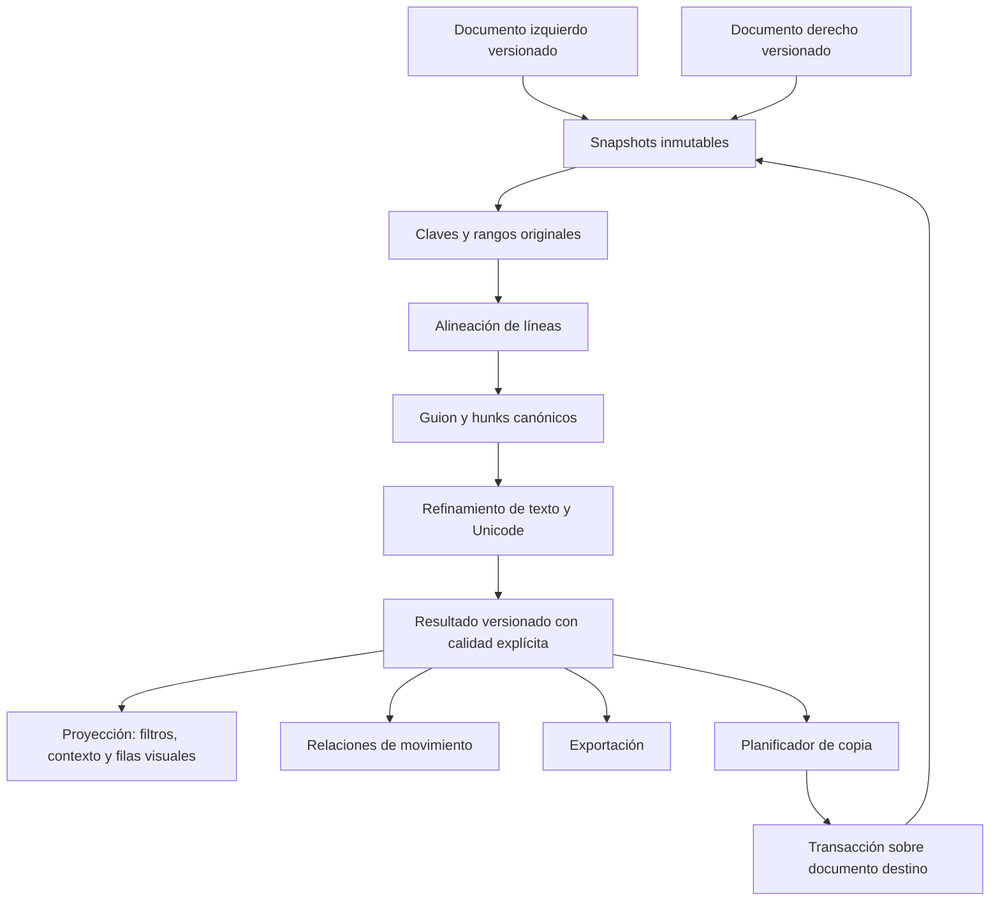

# Revisión del motor y arquitectura para copia bidireccional

Fecha: 21 de octubre de 2026. Estado: diagnóstico histórico anterior a la implementación. Los problemas y mediciones de este documento describen el motor anterior; consulta el [estado implementado](ENGINE_IMPLEMENTATION.es.md) para los cambios y límites actuales.

## Dictamen

El motor actual sirve como prototipo funcional, pero todavía no demuestra precisión y estabilidad al nivel de Beyond Compare en entradas difíciles. Antes de añadir las flechas conviene separar el documento editable, el resultado canónico del diff y su presentación. Las mejoras de rapidez anteriores conservan el contenido, pero ciertos límites abandonan la búsqueda de coincidencias finas. Conservar cada línea no equivale a delimitar correctamente cada cambio.

La meta verificable es: transformación exacta, diferencias sin ocultaciones fuera de la política elegida, alineación legible y estable, edición reversible y latencia medida sobre un corpus representativo. La preferencia entre alineaciones válidas requiere ejemplos de referencia; no se decide solo contando operaciones ni midiendo un archivo favorable.

## 1. Qué muestran las fuentes primarias

### Beyond Compare

Su documentación expone alineación Standard, Myers y Patience, tolerancia al desplazamiento y emparejamiento por proximidad. También reconoce que algunas alineaciones requieren intervención manual. No publica en esa página todos los detalles de su estrategia Standard. No debemos atribuirle internamente un algoritmo no documentado ni prometer superioridad sin una comparación controlada. [Configuración de alineación](https://www.scootersoftware.com/v5help/sessiontextalignment.html).

Las acciones Copy to Right / Copy to Left se describen como copia de líneas seleccionadas o de la sección actual, según la acción. La referencia funcional para nosotros debe distinguir línea, bloque y selección, y mantener deshacer. [Comandos de Text Compare](https://www.scootersoftware.com/v5help/commandstext.html). Parte de la web del fabricante respondió con mantenimiento durante la consulta; esta descripción también apareció en la documentación indexada. No se evaluó el ejecutable de Beyond Compare.

### Familias de algoritmos

| Técnica | Qué aporta | Límites y uso propuesto |
| --- | --- | --- |
| Myers / shortest edit script | Encuentra un guion mínimo de inserciones y eliminaciones cuando se ejecuta sin cortes sobre la secuencia y la igualdad elegidas. Su coste O((n+m)D) favorece documentos parecidos. | Puede alinear coincidencias poco informativas. Evaluar su variante de espacio lineal para regiones grandes; no confundir guion mínimo con presentación más legible. |
| LCS / programación dinámica con puntuación | Permite favorecer continuidad, líneas informativas y correspondencias coherentes. | O(nm): usar en regiones pequeñas o con bandas y un presupuesto explícito, no en matrices de archivos completos. |
| Patience | Utiliza coincidencias únicas como anclas y mantiene su orden. | Puede quedarse sin anclas en código repetido. Aplicarlo por región y disponer de otro algoritmo para los huecos. |
| Histogram | Amplía la estrategia de anclas a elementos de baja frecuencia. | La elección de anclas sigue siendo heurística. Es un candidato a estrategia inicial para código; hay que validarlo frente al corpus. |
| Alineación ponderada de reemplazos | Evalúa conjuntamente las parejas y los huecos, conservando el orden. | Evita la decisión voraz de la primera línea. Su coste debe limitarse por región, con costes de hueco y reglas de desempate explícitos. |
| Refinamiento y ajuste de límites | Desplaza o agrupa límites para seguir palabras, indentación y estructura visual. | No debe cambiar qué contenido es realmente igual ni eliminar cambios del resultado canónico. |
| Comparación sintáctica | Puede reconocer estructura cuando el código cambia de formato. | Es una capa opcional para lenguajes soportados; no sustituye el diff textual de texto libre ni demuestra equivalencia semántica. |

Myers describe tanto el algoritmo base como una variante de memoria lineal. [Artículo original](https://neil.fraser.name/writing/diff/myers.pdf). Git ofrece Myers, minimal, Patience e Histogram y permite heurísticas de indentación. [Manual de Git](https://git-scm.com/docs/git-diff). JGit documenta el uso recursivo de elementos de baja frecuencia en Histogram y la necesidad de un algoritmo de respaldo. [HistogramDiff](https://archive.eclipse.org/jgit/site/5.2.0.201812061821-r/org.eclipse.jgit/apidocs/org/eclipse/jgit/diff/HistogramDiff.html).

### Arquitecturas modernas observables

VS Code combina programación dinámica y Myers según el tamaño, refina regiones modificadas a rangos de texto, ajusta límites y detecta movimientos en otra fase. También devuelve si se agotó el tiempo. Esto respalda una arquitectura por etapas; no implica que debamos copiar sus umbrales. Se inspeccionó el código en el commit `dee4420c5733ffa8bdfdc9b67cfb2883832d4ac1`. [DefaultLinesDiffComputer](https://github.com/microsoft/vscode/blob/dee4420c5733ffa8bdfdc9b67cfb2883832d4ac1/src/vs/editor/common/diff/defaultLinesDiffComputer/defaultLinesDiffComputer.ts).

Diff Match Patch muestra por qué una pasada por líneas, seguida de refinamiento y ajuste de límites, puede mejorar la lectura; sus límites de trabajo pueden producir resultados correctos pero menos precisos en su alineación. [Diff Strategies](https://neil.fraser.name/writing/diff/).

Unicode distingue unidades de código, puntos de código y grafemas percibidos. El resaltado y la copia parcial deben respetar estos últimos cuando corresponda. [UAX #29](https://www.unicode.org/reports/tr29/).

Difftastic compara árboles sintácticos y utiliza una ruta textual de respaldo para formatos no soportados o entradas muy grandes. Lo consideraría una referencia para una futura vista de código, manteniendo el texto como base editable. [Manual](https://difftastic.wilfred.me.uk/introduction.html).

DiffPlex separa su interfaz de diferencias de bajo nivel del modelo lado a lado. Conviene evaluarlo como candidato y como referencia adicional de pruebas, detrás de interfaces propias; adoptarlo no resolvería automáticamente nuestras reglas de Unicode, versiones y copia. [API del proyecto](https://github.com/mmanela/diffplex/blob/master/README.md).

## 2. Diagnóstico del código actual

Se ejecutó un programa externo al repositorio contra la DLL Release del motor, sin editar código de aplicación. Las entradas, resultados y huellas del motor se resumen en [engine-probes.json](engine-probes.json).

| Hallazgo verificado | Resultado | Implicación |
| --- | --- | --- |
| Línea de 4.302 caracteres por lado con dos sustituciones separadas por 2.100 caracteres comunes | Se resaltan 2.102 caracteres de la izquierda, aunque cambiaron dos. | `WordDiff` usa prefijo/sufijo para más de 8.000 caracteres combinados. El contenido se conserva, pero el detalle interno es demasiado amplio. |
| Similitud sobre esas mismas líneas | Devuelve 100. | La función compara como máximo los primeros y últimos 100 caracteres de cada línea. Ese valor es heurístico y no certifica igualdad. El estado `Equal` actual se verifica por otra ruta; este diagnóstico no demuestra un falso `Equal`. |
| Cambio de 😀 a 😁 | El sustituto alto UTF-16 queda en un segmento igual y el bajo en uno cambiado. | Los segmentos dividen un carácter visible. Hace falta segmentación Unicode con correspondencia a offsets UTF-16 del editor. |
| Bloques de 300 líneas distintas, 20 líneas `COMMON` repetidas y otras 300 distintas en cada lado | La salida no contiene ninguna fila `Equal`, aunque ambos conservan las 20 líneas comunes. | Al superar D=512 se devuelve eliminar todo + insertar todo. La reconstrucción de ambos originales sí se conserva. |
| Izquierda: `abcdef`, `abcdeg`; derecha: `abcxxf`, `abcdee` | Agregada, modificada, eliminada, en vez de dos parejas modificadas. | El emparejamiento voraz elige 83 sobre 66 para la primera línea y sacrifica la segunda pareja de 83. Es una limitación de presentación, no pérdida de texto. |

Entradas del caso largo:

```text
L = 'a' × 2100 + 'X' + 'm' × 2100 + 'Y' + 'z' × 100
R = 'a' × 2100 + 'U' + 'm' × 2100 + 'V' + 'z' × 100
```

Observaciones adicionales por inspección:

- `FindAnchors` mezcla anclas exactas y parecidas antes de elegir la subsecuencia. Una candidata parecida puede competir con coincidencias exactas más fiables. Conviene fijar primero las exactas y refinar dentro de los huecos.
- La búsqueda de parecidos usa una ventana absoluta de ±20 líneas. Un gran desplazamiento necesita un mapa basado en anclas vecinas, no solo en el índice original.
- Hay un presupuesto global de 100.000 comparaciones de similitud y una ventana de 32 inserciones en el emparejamiento. Son protecciones útiles, pero actualmente modifican el resultado definitivo en vez de describir una fase provisional pendiente de refinamiento.
- `WordDiff` compara cada pareja de líneas por separado. Así no puede seguir texto conservado que pasó de una línea a varias o viceversa.
- El refinamiento de caracteres también se simplifica al superar D=256. Su resultado no comunica por sí mismo que ese detalle es aproximado.
- La UI normaliza CRLF/LF/CR antes del motor. Por tanto, «exacto» actualmente significa contenido de las líneas, no identidad de terminadores ni de bytes.
- `ChangeBlock(Start, End)` solo almacena posiciones en la lista alineada. No define offsets de inserción vacíos, rangos de texto originales ni versiones de documento.
- Las vistas filtradas materializan textos con líneas fantasma y rótulos de filas ocultas. Son presentación y nunca pueden ser la entrada de una operación de copia.
- Las cadenas del ViewModel representan los originales editables, pero aún no hay una sesión con documentos canónicos, identidad de hunk por versión y transacciones de copia.

Referencias locales: `DiffComparer.Core/DiffEngine.cs`, `DiffComparer.Core/LineMap.cs`, `DiffComparer.UI/Models/ComparisonSnapshot.cs`, `DiffComparer.UI/ViewModels/MainWindowViewModel.cs`, `DiffComparer.UI/Views/MainWindow.axaml.cs`.

## 3. Contratos que debe cumplir el nuevo motor

1. **Reconstrucción:** el guion exacto aplicado a L produce R, incluidos salto final y contenido Unicode; su inverso produce L. Las reglas de final de línea se especifican explícitamente.
2. **Igualdad:** en modo exacto solo se declara igual contenido realmente igual. La similitud jamás es el comparador de igualdad.
3. **Cobertura:** cada rango de origen pertenece a una partición ordenada, sin pérdidas, solapamientos ni duplicaciones. Los huecos de inserción tienen longitud cero y una posición válida, también en EOF.
4. **Detalle:** los rangos internos conservan todos los tokens y sus offsets; un resultado aproximado se distingue de uno refinado. El ajuste visual a palabras no reemplaza el guion exacto.
5. **Unicode:** los límites visibles no parten parejas de sustitutos, secuencias combinadas ni CRLF. Los offsets públicos que consume AvaloniaEdit siguen siendo UTF-16 y se obtienen mediante mapas.
6. **Versiones:** cada resultado identifica ambas versiones de documento y la revisión de opciones. No se publican resultados ni se aplican hunks contra versiones distintas.
7. **Determinismo:** entrada, política y estrategia iguales producen el mismo resultado. Los desempates están documentados y tienen pruebas.
8. **Independencia de la vista:** ocultar filas, buscar o marcar revisado no modifica el guion de edición ni sus rangos.

Separar tres conceptos evita garantías engañosas: cobertura completa del contenido, calidad de alineación y nivel de detalle interno. Un resultado que conserva todo el texto puede seguir teniendo una alineación provisional y un detalle grueso.

## 4. Arquitectura propuesta



### Documentos

`DocumentSession` mantiene dos documentos canónicos, metadatos de codificación/BOM/terminadores, estado modificado y una referencia a la última versión guardada. Abrir, editar, copiar y deshacer actúan sobre esos documentos.

AvaloniaEdit ya implementa `TextDocument` con rope, árbol de líneas, versiones, snapshots, `Replace`, grupos de actualización y pila de deshacer. Se verificaron esas capacidades en su fuente upstream; el adaptador debe probar las firmas y el comportamiento de la versión 11.1.0 instalada. No hace falta construir un editor o un rope nuevos. [TextDocument](https://github.com/AvaloniaUI/AvaloniaEdit/blob/master/src/AvaloniaEdit/Document/TextDocument.cs).

Para una primera migración segura, la vista actual puede permanecer como proyección de solo lectura, separada de los documentos canónicos. Posteriormente se puede evaluar espaciado y plegado virtuales para reducir reconstrucciones. Reasignar `TextEditor.Text` en una proyección no debe modificar el documento canónico ni su historial.

### Resultado canónico

Contratos orientativos, no código implementado:

```csharp
record TextRange(int Offset, int Length); // [Offset, Offset + Length), UTF-16
record LineRange(int Start, int Count);   // cero basado; Count=0 para inserciones

record DiffHunk(
    HunkId Id,
    LineRange LeftLines, LineRange RightLines,
    TextRange LeftText, TextRange RightText,
    ImmutableArray<InnerChange> InnerChanges);

record DiffSnapshot(
    SnapshotId Id,
    DocumentVersion LeftVersion, DocumentVersion RightVersion,
    OptionsVersion OptionsVersion,
    ImmutableArray<ExactEdit> RawEdits,
    ImmutableArray<DiffHunk> Hunks,
    AlignmentQuality AlignmentQuality,
    DetailQuality DetailQuality);
```

Los tipos son esquemáticos. Un `HunkId` solo es válido dentro de su snapshot; no es una fila ni un índice persistente. `LineMap`, números visuales y `VisibleBlocks` se derivan de esos rangos. Conviene mover el resultado independiente de UI a Core y dejar filtrado/renderizado en UI.

Mantener separadas las ediciones textuales y su importancia permite distinguir diferencias ignoradas de igualdad real. La política debe definir espacios iniciales/interiores/finales, mayúsculas, terminadores y salto final. El texto de origen siempre se conserva intacto.

### Etapas del cálculo

1. Recortar regiones idénticas al inicio y final sin destruir offsets originales.
2. Internar claves de líneas, comprobando igualdad real cuando se utilicen hashes. Mantener mapas de la clave normalizada al texto original si esa política afecta al detalle.
3. Resolver anclas exactas por regiones. Evaluar Histogram y Patience como estrategias intercambiables, con Myers de respaldo.
4. Procesar regiones pequeñas con programación dinámica ponderada; las grandes con un algoritmo de memoria acotada y refinamiento posterior si procede.
5. Construir hunks mediante rangos de ambos documentos, sin obligar a emparejar una línea con otra.
6. Refinar el texto del hunk completo, incluidos saltos entre líneas, para soportar divisiones y uniones de líneas.
7. Usar tokens de palabras, espacios y símbolos para acelerar; refinar los tokens distintos a grafemas y mapearlos de vuelta a offsets UTF-16. Ningún token se descarta.
8. Ajustar los límites de presentación para mejorar legibilidad, conservando las ediciones exactas.
9. Detectar movimientos como relaciones adicionales entre rangos. La detección no cambia el guion canónico ni convierte similitud en igualdad.
10. Crear índices de vista y resultados exportables a partir del mismo snapshot.

Ofrecería una estrategia de lectura humana y una estrategia de guion mínimo como opciones separadas. La primera puede conservar anclas aunque no logre el mínimo global; ambas deben ser exactas respecto al contenido y transparentes respecto a su calidad.

## 5. Las flechas: una edición de documento, no una operación visual

Una flecha derecha aplica conceptualmente:

```text
destino.Reemplazar(hunk.RightText, origen.Leer(hunk.LeftText))
```

La izquierda intercambia los papeles. Los rangos vienen del snapshot canónico validado, nunca de la selección visual, de filas fantasma, de texto normalizado ni del porcentaje de similitud.

| Contenido izquierdo del hunk | Contenido derecho | Copiar izquierda → derecha |
| --- | --- | --- |
| Texto | Rango vacío | Insertar en la posición derecha explícita |
| Rango vacío | Texto | Eliminar ese rango derecho |
| Texto A | Texto B | Reemplazar B por A |
| Salto final o última línea | Diferencia en EOF | Aplicar el rango exacto y la política de terminadores |

### Secuencia de una copia

1. La UI envía snapshot, hunk y dirección; opcionalmente un subrango validado para copia parcial.
2. El controlador verifica identidad y versiones de los dos documentos, opciones y editabilidad del destino. Un comando obsoleto no se reubica por coincidencia aproximada: se recalcula.
3. Se captura el contenido de origen desde el snapshot correspondiente y se valida el contenido esperado del destino.
4. Se prepara la sustitución con una regla explícita para EOL: conservar estilo del destino o copiar terminadores del origen. Los bordes de archivo, la falta de salto final y los rangos vacíos tienen casos propios.
5. En el hilo propietario del documento se ejecuta una transacción, por ejemplo usando `RunUpdate`/`Replace`. Un clic genera un único paso de deshacer y solo cambia el destino.
6. Se actualiza la versión, el estado modificado y la posición de navegación. Las acciones del snapshot antiguo se invalidan inmediatamente para impedir un segundo clic contra rangos vencidos.
7. Se capturan snapshots nuevos y se recalcula en segundo plano. Solo se publica el resultado si ambas versiones y la revisión de opciones siguen coincidiendo.
8. Se conserva el foco y la posición por ancla de documento; las revisiones se mantienen únicamente para bloques cuyo contenido y contexto se puedan verificar como inalterados.

Primero implementaría recálculo completo en segundo plano: será la referencia de corrección. Después añadiría recálculo local entre límites fiables, siempre comparándolo con el completo y volviendo a este cuando cambien anclas globales, frecuencias o relaciones de movimiento. No basta con recalcular «las cinco líneas alrededor».

La aplicación de parches aproximados es un problema distinto. El ejemplo y la discusión de fuzzy patch muestran el riesgo de elegir texto parecido en otro lugar; para dos documentos abiertos y versionados no necesitamos esa ambigüedad. [Fuzzy Patch](https://neil.fraser.name/writing/patch/).

### Casos que requieren una decisión explícita

- **Filtros:** una flecha no debe copiar accidentalmente cambios ocultos dentro de un bloque. Asociar acciones a unidades canónicas completas; cuando una unidad esté parcialmente oculta, mostrarla completa antes de habilitar su aplicación.
- **Movimientos:** copiar un bloque sigue siendo una copia local. No implica eliminar automáticamente su pareja en otro lugar. Una futura acción «aplicar movimiento» sería una transacción distinta y explícita.
- **Deshacer:** Ctrl+Z después de la flecha debe actuar sobre el documento canónico destino, también desde la vista comparada. Deshacer y rehacer disparan el mismo circuito de invalidación y recálculo.
- **Cambios solo de espacios:** ignorarlos para navegación no autoriza a modificar otros espacios del documento destino. Copiar únicamente el rango seleccionado por la acción.
- **Bloques provisionales:** no habilitar una copia fina basada en un hunk todavía pendiente de refinamiento.
- **Guardado:** copiar modifica el documento en memoria. Guardar es una acción independiente, con su codificación, BOM y política de terminadores.

## 6. Rapidez sin sacrificar la precisión final

- Capturar snapshots y editar en el hilo del documento; trabajar con esos snapshots inmutables en los workers.
- Cancelar el trabajo obsoleto y verificar versiones al publicar. Evitar aplicar resultados parcialmente mezclados de solicitudes distintas.
- Reutilizar buffers de índices y fronteras; evitar un diccionario nuevo por cada profundidad de Myers. Evaluar memoria lineal y pooling con perfiles reales.
- Mantener cachés acotadas por contenido, estrategia y opciones. La reutilización no puede basarse solo en un número de fila.
- Priorizar el detalle visible y el bloque seleccionado. Una vista rápida puede aparecer primero, identificada como provisional, mientras se completa el detalle.
- Conservar los índices por fila y pinceles reutilizados actuales. Una sustitución pequeña no debería convertir ambos documentos completos en nuevas cadenas en el hilo UI.
- Los límites de tiempo y memoria deben producir un estado explícito y una ruta de continuación o cancelación; no un resultado grueso presentado como análisis exhaustivo.
- Medir lectura, alineación, refinamiento, movimientos, proyección, aplicación y renderizado por separado, además de latencia total y asignaciones.

El artículo del búfer de VS Code refuerza que las estructuras de edición y el perfilado real importan tanto como el algoritmo de diferencias; también trata las dificultades de CRLF y las asignaciones temporales. Nuestra recomendación es aprovechar primero el búfer de AvaloniaEdit y medir antes de reemplazarlo. [Text Buffer Reimplementation](https://code.visualstudio.com/blogs/2018/03/23/text-buffer-reimplementation).

## 7. Cómo demostrar «igual o mejor»

### Corpus

Combinar casos sintéticos etiquetados y cambios reales representativos de nuestros usuarios:

- Código C#, JS/TS, Python, SQL y configuración; también texto libre y logs.
- Llaves, líneas vacías, comentarios y bloques repetidos; inserciones grandes y cambios cerca de EOF.
- Identificadores parecidos, modificaciones de un dígito y varios cambios separados en una misma línea.
- Líneas minificadas o muy largas con islas comunes en medio.
- Una línea dividida en varias y varias unidas en una.
- Movimientos exactos, con edición y ambiguos; mezclados con inserciones genuinas.
- CRLF/LF/CR, terminadores mixtos, BOM, archivo vacío, una línea vacía y presencia/ausencia de salto final.
- Acentos combinados, emojis, sustitutos UTF-16 y escrituras no latinas. Normalización Unicode solo cuando se solicite explícitamente.
- Tamaños crecientes y documentos casi idénticos frente a completamente distintos.

### Pruebas

- Propiedades de reconstrucción, cobertura, monotonicidad y rangos válidos sobre miles de entradas generadas.
- Comparación con una implementación sencilla exhaustiva en secuencias pequeñas para validar minimalidad cuando se prometa.
- Casos de referencia para legibilidad e intralínea. No exigir la misma alineación a todos los algoritmos válidos.
- Aplicar cada hunk en ambas direcciones, incluidos rangos vacíos, inicio y fin; verificar que el resto del destino permanece intacto y el origen no cambia.
- Copiar varios bloques con recálculo entre operaciones; copiar todos debe converger al texto de origen según la política elegida.
- Un paso de deshacer revierte exactamente un clic y rehacer restaura la operación.
- Rechazar clics y resultados obsoletos al editar durante un cálculo; comprobar pulsaciones rápidas, filtros y cambios de opciones.
- Comprobar desplazamiento, foco, revisiones y números originales tras cada copia.
- Medir p50/p95 de latencia y memoria en ejecuciones frías y calientes, registrando hardware, versiones y políticas.

Para comparar con Beyond Compare hay que fijar versión y ajustes equivalentes, guardar las entradas y revisar la calidad de los límites junto con tiempo y memoria. Las 72 pruebas actuales y la medición previa de 20.000 líneas son una buena base de regresión, pero no demuestran esa paridad ni cubren los casos fallidos de este diagnóstico.

## 8. Secuencia recomendada

1. **Contratos y pruebas:** incorporar los casos reproducidos, definir igualdad, EOL, rangos, versiones y calidad de resultado.
2. **Documentos canónicos y adaptadores:** separar presentación, snapshots y sesiones editables; conservar la UI actual donde sea posible.
3. **Motor por etapas:** comparar estrategias detrás de interfaces, corregir refinamiento de líneas largas/Unicode y reemplazar el emparejamiento voraz.
4. **Copia bidireccional:** implementar planificación, validación de versiones, transacción y undo/redo con recálculo completo.
5. **Optimización guiada por medidas:** detalle progresivo, cachés acotadas y recálculo incremental contrastado con el completo.
6. **Evaluación comparativa:** corpus acordado, calidad revisada y métricas reproducibles frente a Beyond Compare y referencias abiertas.

No propongo desechar el proyecto ni añadir las flechas como un parche al renderizado actual. Propongo mantener lo que ya funciona y establecer primero los contratos que permitan medir y garantizar la calidad del motor y de cada edición.
